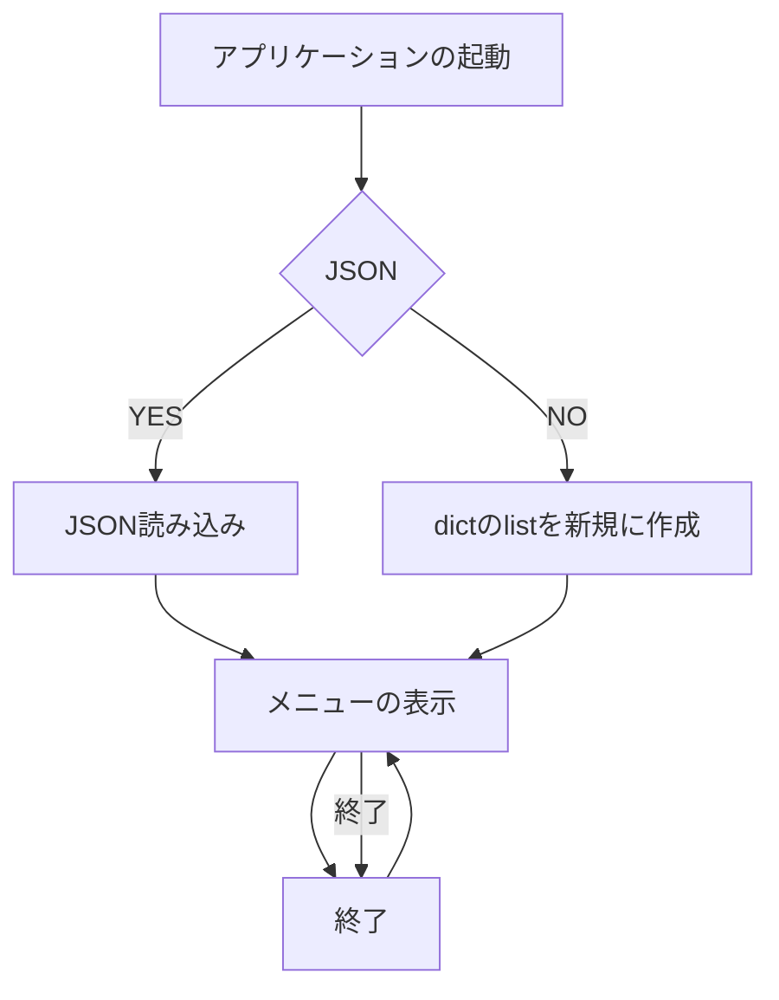

# 001-002-task-management-app
### No.001｜CLIタスク管理アプリ

**作るもの・実装手順**
1. タスクID・タイトル・期限・完了状態を持つデータを設計する
2. 追加・一覧・完了・削除をコマンドから呼べるようにする
3. JSONファイルへ保存し、次回起動時に復元する

**合格確認：** 存在しないIDの完了操作と壊れた保存ファイルを試し、データを破壊せず終了できる
**取り組み方のヒント：** まず「1件を追加して一覧に表示」だけ完成させ、操作を少しずつ追加する
**提出：** ソース・README・動作確認結果・今回の学び（共通の提出ルールに従う）。

No.002｜コマンド引数の解析
作るもの・実装手順

「add」「list」「done」のサブコマンドを定義する
必須引数・任意引数・--helpの表示を設計する
期限の形式や番号の型を検証し、実行結果に終了コードを付ける
合格確認： 引数不足・不明なコマンド・無効な日付をそれぞれ試し、適切な使用方法が表示される 取り組み方のヒント： 標準ライブラリargparseの概念を確認し、入力解析と本体処理を分ける 提出： ソース・README・動作確認結果・今回の学び（共通の提出ルールに従う）。

------
**実装計画**
1. データ設計
- 個々のタスクには、ID・タイトル・期限・完了状態をdict型で格納する
- dict型に格納されたタスクはlistへ格納する（task_listと定義）
2. task_listへのtask追加
- IDは「追加」フラグが作成された時点で一意なものを作成（順番・重複なし）
- input関数でタイトル・期限を定義
- 完了状態はデフォルトで「未完了」
3. 一覧表示
- できれば表形式で表記（方法を調べる）
- forループで実装
4. タスク呼び出し機能の作成
- IDをキーにして当該タスクを呼び出す（fetch）
5. 完了フラグの付与
- fetch→未完了フラグを完了へ変更
6. 削除
- fetch→削除するタスクの確認、削除
7. JSONへの書き出し/読み込み
- 同じディレクトリにJSON形式でdictのlistを書き出す（方法を調べる）
- 保存したJSONを読み込み、dictのlistへ変換（方法を調べる）
8. 各機能の統合

- メニュー：タスク一覧の表示・新規タスクの追加・タスクの完了・タスク削除・JSON書き出し・終了

9. JSON書き出し・読み込みの自動化
- 各操作の最後にJSON・Logを自動で記載するよう仕様変更
